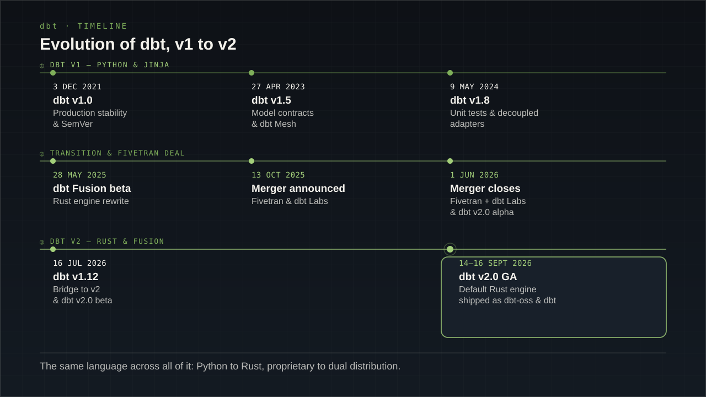

# Choosing Between dbt v1 and dbt v2

dbt has spent roughly five years as a 1.x product. The v1.0 release landed on December 3, 2021, and the series rolled through thirteen minor versions since — the version selector in the docs today lists 1.12 as the latest stable and 1.13 in beta. Along the way it picked up a community of over 100,000 members and became, in its own words, the industry standard for data transformation: you write SQL `select` statements, and the tool handles materialization, transactions, DDL and schema changes in your warehouse.

On September 14, 2026, dbt Labs shipped v2.0, and this release is not another minor bump. The engine is rewritten in Rust with a native understanding of SQL across warehouse dialects, and the surrounding product has been reorganized around AI: dbt Wizard investigates, builds, validates and ships from natural language, grounded in the lineage, tests, contracts and metrics your project already produces. dbt Labs frames the structured context a dbt project creates — how your data connects, what it means, what a change may affect — as exactly what an AI agent needs to work safely. That framing, plus a changed license, is why v2 deserves a deliberate look rather than an automatic upgrade.

This article compares the two generations on the dimensions that actually decide the choice: runtime, install defaults, editor tooling, licensing and support timelines. By the end you should be able to name which generation fits your constraints, and know the migration path if you pick v2.

## Two generations of the same framework

Both versions speak the same dbt language: SQL select statements, Jinja templating, YAML configs and tests, the code you actually write. Both compile that project, execute the transformation graph, and produce metadata. The split is in the engine underneath.

v1 is the original Python-based CLI, released under the Apache 2.0 license, still maintained on the 1.x series. v2 is the current Rust-based generation and the default when you install dbt. The licensing page is blunt about what changed: dbt v2 is proprietary to dbt Labs under the dbt Product Licensing Agreement, though it remains completely free to use, and a fully open-source Apache 2.0 distribution of the same Rust engine ships as `dbt-oss`. So "is v2 open source?" has a two-part answer: the recommended `dbt` package is not, and the `dbt-oss` package is.

The upgrade guide describes v2 as "faster and stricter, but your existing project language and DAG semantics carry over, so once you upgrade, your project works as before — just faster." Stricter is the operative word: v2 drops all deprecated functionality, so every deprecation warning in your project must be resolved before the new engine will run it.

## The dimensions that decide

| Dimension | dbt v1 | dbt v2 |
| --- | --- | --- |
| Runtime | Python-based | Rust-based |
| License | Apache 2.0 | Proprietary (dbt Product Licensing Agreement); `dbt-oss` distribution is Apache 2.0 |
| Install default | Separate v1.x install | `python -m pip install dbt` gives you v2 by default |
| Initial release | Dec 3, 2021 (v1.0) | Sept 14, 2026 (v2.0) |
| Support | v1.3–v1.7 removed from dbt platform on Feb 28, 2027; v1 overall "still fully supported" | Active support through Sept 13, 2027 |
| Editor features | dbt VS Code extension available | Extension plus SQL comprehension, lint, column-level lineage |
| Platform sign-in | Not required | Unlocks some capabilities with a free dbt platform account |

One install detail worth knowing: `dbt-oss` and `dbt` cannot share a Python environment, so test them in separate virtual environments if you want to compare.

<figure markdown>
{ width="80%" }
</figure>

## Where v2 earns its keep

The Rust engine's SQL comprehension is the headline, and it shows up as four things you notice in the first hour:

- Incorrect SQL is caught in your models before it ever hits the warehouse — syntax error detection across Jinja, YAML and SQL, marked "free forever" on the feature availability page.
- Autocomplete, hover info and inline errors as you type, through the dbt VS Code extension.
- Inline CTE previews for faster debugging, part of the LSP feature set (Language Server Protocol, the same editor-integration standard your IDE uses elsewhere).
- Tracing of model and column definitions across the entire project, including precise column-level lineage in the full version of dbt docs v2.

Some of this list is free without any account: syntax error detection, `dbt lint`, dbt docs v2 lite, and the lite LSP (go-to ref, source and macro). The fuller capabilities — the Catalog tab in the editor, full LSP features — arrive when you run `dbt login` and sign in with a free dbt platform account. None of it requires a paid plan.

## Where v2 costs you

The first cost is legal rather than technical. If your organization's license policy requires a strict open-source distribution, the recommended `dbt` package is off the table; you install `dbt-oss` instead, which the licensing page positions for exactly that requirement or for building custom work on the OSS code itself.

The second cost is migration effort on an existing project. All deprecation warnings — including historic ones and new ones as of dbt v1.10 — must be resolved before upgrading. Behavior change flags marked `2.0` are removed, meaning the new behavior is always enabled and you can no longer opt out via `flags:` in `dbt_project.yml`. External packages may not have updated their `require-dbt-version` to include `2.0.0` yet. The docs describe the work as "simple, straightforward, and in many cases, auto-fixable" with the `dbt-autofix` helper, but it is work.

The mitigation is well designed: v2 produces a `v12` manifest that v1 safely ignores, so you can run the two versions side by side and migrate incrementally without breaking existing v1 jobs. If you are on v1.12, you can even test parser compatibility first with the opt-in `--use-v2-parser` flag, which delegates only parsing to the v2 engine.

## Who should pick which

Three situations cover most readers.

**Starting a new project today.** Install v2. Run `python -m pip install dbt`, verify with `dbt --version`, then `dbt login` if you want the platform-gated features. There is no reason to begin on v1, and dbt Labs says new capabilities will land in v2 only over time.

**The strict-OSS shop.** Your license policy decides for you. The choice is `dbt-oss` for v2 or staying on v1, which remains Apache 2.0 and fully supported. Only you can weigh "still supported" against a deprecation date the docs do not yet state for v1 overall — they do state that v1.3 through v1.7 leave the dbt platform on February 28, 2027.

**A large v1 estate.** Old deprecations and third-party packages make v1 a defensible answer this year. Plan the move anyway: use `--use-v2-parser` to find your compatibility gaps early, run the versions side by side, and treat `dbt-autofix` as the tool that turns the migration into an afternoon rather than a quarter.

The page that continues this work is the upgrade guide: https://docs.getdbt.com/docs/dbt-versions/dbt-upgrade/upgrading-to-v2

Source: https://docs.getdbt.com/docs/introduction?version=2
