# Run your first Sympozium agent with kubectl

Every agent framework I have watched a team adopt ends up with the same work pushed into application code: a place to run the agent, a way to stop it touching what it should not, and a scheduler. Sympozium's bet is that those are Kubernetes primitives you already operate — a Job for the run, a CronJob for the schedule, a Sympozium object for the guardrails. A controller, the loop that keeps making the cluster match what you declared, does the wiring.

{ width="80%" }

## What Sympozium is, and the resources you write

Sympozium is a Kubernetes-native platform for orchestrating AI agent teams. Every concept a framework keeps in code is a custom resource instead — a custom resource definition, or CRD, being the schema that teaches the cluster to store and validate a new kind of object next to Pods and Services. This article uses seven:

- `Agent` — one agent's model, credentials, skills and policy.
- `AgentRun` — one task handed to that Agent, which becomes a Job.
- `SympoziumPolicy` — the tools a run may use, checked before it starts.
- `SkillPack` — tool instructions plus the sidecar container carrying the binary.
- `SympoziumSchedule` — a cron expression that fires a run on its own.
- `Ensemble` — a pack of personas that creates their Agents and schedules.
- `MCPServer` — a shared service handing Agents tools from outside.

## 1. Prerequisites

A running Kubernetes cluster (Kind, minikube, EKS, GKE, AKS all work), a `kubectl` pointing at it, and an LLM provider — an API key for OpenAI, Anthropic, or a cluster-local model such as Ollama. Nothing about models is asked at install time.

## 2. Install Sympozium

```bash
brew install sympozium-ai/sympozium/sympozium
```

`sympozium version` confirms the binary is on your `PATH`.

```bash
sympozium install
```

That deploys the control plane into a new `sympozium-system` namespace: the CRDs, the controller, an event bus called NATS that carries messages between the controller and the agent pods, and an admission webhook, the piece Kubernetes asks for a verdict before it accepts a run. Rerunning the command is the upgrade path.

## 3. Configure the LLM provider

Sympozium reads credentials from Kubernetes Secrets, not from your shell. Create one for OpenAI:

```bash
kubectl create secret generic my-openai-key \
  --from-literal=OPENAI_API_KEY=sk-...
```

The key name is not free-form: `OPENAI_API_KEY` for OpenAI, `ANTHROPIC_API_KEY` for Anthropic. A local provider still needs a Secret, filled with the placeholder `not-needed`.

## 4. Create your first Agent

An Agent declares which model to use, which skills to mount, and which policy to follow. Save this as `instance.yaml`; it defines the Agent `my-first-agent`, pointing at the Secret you just made:

```yaml
apiVersion: sympozium.ai/v1alpha1
kind: Agent
metadata:
  name: my-first-agent
spec:
  agents:
    default:
      model: gpt-4o
  authRefs:
    - provider: openai
      secret: my-openai-key
  skills:
    - skillPackRef: k8s-ops
  policyRef: permissive
```

```bash
kubectl apply -f instance.yaml
```

```bash
kubectl get agent my-first-agent
```

You should see `Phase: Running`, or `Pending` briefly while the controller reconciles. `authRefs` is the link to the Secret, and a provider name with no matching Secret is the usual reason a first run fails. `policyRef` names a `SympoziumPolicy`, and `permissive` is the built-in one that allows every tool — fine on a dev cluster and wrong anywhere else.

## 5. Fire your first run

An Agent with a phase is configured, not working. Work happens in an AgentRun. Save this as `run.yaml`; it names the Agent you just created:

```yaml
apiVersion: sympozium.ai/v1alpha1
kind: AgentRun
metadata:
  name: my-first-run
spec:
  agentRef: my-first-agent
  agentId: primary
  sessionKey: "session-001"
  task: "List all pods in every namespace and summarise their health. Report any pods that are not Running."
  model:
    provider: openai
    model: gpt-4o
    authSecretRef: my-openai-key
  skills:
    - skillPackRef: k8s-ops
  timeout: "5m"
```

```bash
kubectl apply -f run.yaml
```

Then watch the phase:

```bash
kubectl get agentrun my-first-run
```

```
NAME           INSTANCE         PHASE     POD                        AGE
my-first-run   my-first-agent   Pending                              0s
my-first-run   my-first-agent   Running   my-first-run-agent-xxxxx   5s
my-first-run   my-first-agent   Succeeded my-first-run-agent-xxxxx   45s
```

`Succeeded` means the agent finished. The Job's pod has three containers: `agent-runner`, the `ipc-bridge` sidecar that publishes activity to the NATS event bus, and `skill-k8s-ops`, the sidecar holding `kubectl`. That sidecar gets an RBAC role bound to its pod only, and both are garbage-collected when the run ends.

## 6. Read what the agent said

The final response lives in the AgentRun's `status.result`:

```bash
kubectl get agentrun my-first-run -o jsonpath='{.status.result}'
```

`status` also carries `phase`, `error`, `podName`, `tokenUsage`, the model tokens the run spent, and `traceID`, the run's recorded trace when the cluster collects one. For tool calls and reasoning, read the pod log:

```bash
kubectl logs -l sympozium.ai/agent-run=my-first-run -c agent
```

When the result is empty rather than wrong, that log is where the cause is.

## Extra: Two more things you need

The walk-through uses three resources: `Agent`, `AgentRun` and `SympoziumPolicy`. Two more cover what a single Agent cannot do.

### An Ensemble: a pack of agents

An `Ensemble` replaces hand-written Agent files with one pack. Each persona in `agentConfigs` becomes its own Agent, with its own SympoziumSchedule and memory ConfigMap, owned by the Ensemble — delete the pack and the controller deletes what it made. Two personas, one wired to start it and one that waits for the first to finish:

```yaml
apiVersion: sympozium.ai/v1alpha1
kind: Ensemble
metadata:
  name: research-pipeline
spec:
  workflowType: pipeline
  stimulus:
    name: kickoff
    prompt: "Begin the daily research workflow. Summarize developments in AI safety from the last 24 hours."
  agentConfigs:
    - name: lead
      systemPrompt: "You are a lead researcher coordinating the team."
    - name: analyst
      systemPrompt: "You are a data analyst."
  relationships:
    - source: kickoff
      target: lead
      type: stimulus
    - source: lead
      target: analyst
      type: sequential
```

`workflowType: pipeline` plus the `sequential` edge is what makes the second persona wait. Applying it leaves the pack inactive: it needs `authRefs` before the controller stamps out anything, and the docs activate it by patching those onto the existing pack.

### An MCPServer: tools from outside the cluster

An `MCPServer` gives Agents tools that live outside the cluster, over the Model Context Protocol, a standard way to expose tools to a model. Sympozium runs them as shared services, and every Agent reaches them over HTTP through an `mcp-bridge` sidecar. This one exposes Kubernetes networking diagnostics:

```yaml
apiVersion: sympozium.ai/v1alpha1
kind: MCPServer
metadata:
  name: k8s-networking-mcp
  namespace: sympozium-system
spec:
  transportType: http
  toolsPrefix: k8s_net
  timeout: 30
  deployment:
    image: ghcr.io/henrikrexed/k8s-networking-mcp:latest
    port: 8080
    env:
      LOG_LEVEL: "info"
    serviceAccountName: k8s-networking-mcp
    resources:
      requests:
        cpu: 100m
        memory: 128Mi
      limits:
        cpu: 500m
        memory: 256Mi
```

The `serviceAccountName` is the permissions half: the server reads the cluster through that ServiceAccount, so it needs networking RBAC. Filtering matters too — the page puts this server at 42 tools at roughly 300 tokens each, so an Agent that needs five lists those five under `toolsAllow`.

## Next: Five agents you can build

You have an Agent, a run you can read, a policy and an outside tool. Keep playing: each idea below reuses a resource you already applied, so the next one costs a YAML file rather than a new platform.

- A cluster health checker: the Agent from step 4, on a `SympoziumSchedule` of `0 * * * *` so the summary lands hourly.
- A deployment reviewer: an Agent whose `task` asks for a diff against the last release, triggered whenever a manifest changes.
- A networking triage agent: the `k8s-networking-mcp` above, attached under `mcpServers`, with `toolsAllow` cut to the diagnostics you use.
- A Slack or Telegram bot: Sympozium ships channel integrations for Slack, Telegram, Discord and WhatsApp, so the Agent answers in the channel instead of in an AgentRun you watch.
- A two-persona report team: the `research-pipeline` Ensemble with `authRefs` patched in, so the lead researches on a schedule and the analyst writes when it finishes.

The getting-started guide at https://deploy.sympozium.ai/docs/getting-started/ walks the dashboard and TUI where you enable a pack and bind a channel.

Source: https://deploy.sympozium.ai/docs/
